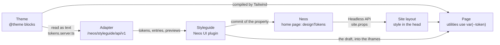
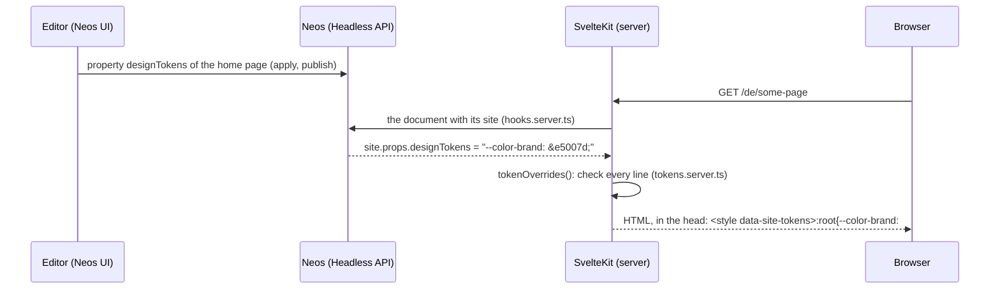

# How the design tokens and the styleguide work

This explains the whole way of a design token: from the CSS where it is defined, through Neos where a site changes it,
to the page that renders it; and how the styleguide in the Neos content module reads the tokens and the components of
the frontend. The [README](README.md) says what the package does, [PROTOCOL.md](PROTOCOL.md) is the exact contract
between the interface and a frontend.

## The parts

| Part | Where | Job |
| --- | --- | --- |
| Theme | `Frontend/src/lib/design/styles/*.css` | defines every token with its default, in `@theme` blocks; the only list of tokens |
| Token reader | `Frontend/src/lib/design/tokens.ts`, `tokens.server.ts` | reads the tokens from that CSS; checks the overrides of a site |
| Overrides of a site | Neos, home page, property `designTokens` (`Devclaim.NeosStyleguide` `DesignTokensMixin`) | the tokens a site changes, one `--name: value;` per line |
| Headless API | `NeosSvelte.Headless` | delivers the site with every page, `designTokens` included |
| Site layout | `Frontend/src/routes/(site)/+layout.server.ts`, `+layout.svelte` | writes the overrides of the site into the `<head>` of each page |
| Catalogue | `Frontend/src/lib/**/*.styleguide.yaml`, `Frontend/src/lib/styleguide/` | describes the components for the styleguide (props, use cases, examples) |
| Adapter | `Frontend/src/routes/neos/styleguide/` | answers the styleguide protocol: entries, tokens, previews |
| Interface | `Devclaim.NeosStyleguide`, a plugin of the Neos UI | the styleguide in the content module and the editor of the tokens |

The interface knows nothing about SvelteKit: everything it shows comes from the adapter (protocol) and from the Neos
UI (the property). Another frontend (a classic Neos project with Fusion or CPX) would implement the adapter and keep
the interface.



## 1. The theme: the CSS is the source

The tokens are CSS custom properties in the `@theme` blocks of `Styles.css` and `Typography.css`:

```css
@theme static {
    /* Group: Semantic colors - the only colors components use */
    --color-brand: var(--color-sd-50); /* primary actions (buttons) */
    --color-brand-hover: var(--color-sd-60);
}
```

- **Tailwind turns them into utilities.** `--color-brand` gives `bg-brand`, `text-brand`, `border-brand` …, and the
    utilities do not contain the value but the variable: `.bg-brand { background-color: var(--color-brand) }`. So
    changing the variable changes every element that uses the utility, without building the CSS again.
- **`static`** makes Tailwind write every token to `:root`, also the ones no utility uses, so an override can refer to
    any token (`var(--color-oc-10)`). Costs about 0.6 kB gzip.
- **Two layers of colors.** The scales (`--color-sd-10` … `--color-sd-100`, `gr`, `su`, `er`, `oc`, `pe`) are the
    palette; the semantic tokens (`--color-surface`, `--color-text`, `--color-brand` …) map the palette to a purpose.
    Components only use the semantic tokens. A site that changes `--color-brand` changes every button, link and
    highlight that means "brand", and nothing else.
- **Comments are data.** A comment `/* Group: <label> - <description> */` starts a group (other comment lines are only
    for developers); the comment behind a token is its description. Both are for developers: the adapter delivers
    them, the styleguide does not show them.
- **Build time tokens.** `--breakpoint-*` and `--container-*` end up in media queries. A media query cannot use a
    custom property, so these are fixed when the CSS is built; a site cannot change them (`BUILD_TIME_TOKEN` in
    `tokens.ts`).

## 2. From Neos to the page

How the tokens of a site get into the HTML of its pages:



1. **Stored in Neos.** The property `designTokens` of the home page holds the changed tokens as text, one
    `--name: value;` per line. It has the scope of the node aggregate: one value for all languages. The mixin is part
    of this package (`NodeTypes/Mixin/DesignTokensMixin.php`); the site package gives it to its site node type
    (NeosSvelte.Site `HomePage`).
2. **Delivered with every page.** The Headless API returns the site together with the document
    (`locals.documentWithSite` in `hooks.server.ts`; in the content module with the session of the editor, so the
    workspace is used). `designTokens` is one of the site's props (`site.props.designTokens`, typed in
    `Frontend/src/lib/neos/api.gen.ts`).
3. **Checked.** `(site)/+layout.server.ts` passes it to `tokenOverrides()` (`tokens.server.ts`). A line is taken only if
    - the token exists in the theme,
    - it is not a build time token,
    - the value cannot leave the declaration (no `;`, `{}`, `<>`, `\`, `@`, comments, `url()`, at most 300
        characters),
    - and `var()` only refers to known tokens.

    Lines that are left out are logged by the dev server. The same rules check the styleguide's draft
    (`tokenRejection`, below), so the editor sees why a value is not taken.
4. **Written into the head.** `(site)/+layout.svelte` renders `tokenStyleElement()`:
    `<style data-site-tokens>:root{…}</style>` after the stylesheet and outside its cascade layers, so it wins over
    the defaults. Because the utilities use the variables (1.), this one rule restyles the page.
5. **Cache.** The SvelteKit server caches pages with the Neos cache tags of their content
    (`Frontend/src/lib/server/pageCache.ts`). Publishing the home page purges them like any other change of it:
    `FrontendCacheInvalidator` (`NeosSvelte.Headless`) sends the tags to `POST /__neos/purge`. With
    `BUILD_TARGET=static` the tokens are in the prerendered HTML: a change needs a new build (the webhooks of the
    invalidator can start one), like any content change.

## 3. The draft: tokens before they are saved

A change in the styleguide is a **draft** first (`Resources/Private/JavaScript/draft.ts`, kept in `neos-ui/store.ts`):
the previews show it at once, the workspace has it a moment later.

1. The adapter checks the draft (`POST /neos/styleguide/api/v1/tokens/validate`, 250 ms after the last change, same
    rules as 2.3). Rejected values are shown with their reason in the editor and are not shown anywhere.
2. What the previews get: the value of every editable token as it is now (the draft, else the saved override, else
    the default). Complete on purpose: a preview loaded before the last save stays right without loading again.
3. The interface puts that into the pages itself (`Resources/Private/JavaScript/frames.ts`): a
    `<style data-styleguide-draft>:root{…}</style>` at the end of their `<head>`, after the site's tokens. That works
    because the previews are on the same origin as the Neos UI. The frontend has no code for it.
4. After a pause (700 ms) and when every value is valid, the draft is saved into the editor's workspace
    (`neos-ui/neos.ts`): the change the Neos UI sends for an inline edit (`Neos.Neos.Ui:Property` on the site node,
    property `designTokens`). The Neos UI updates the node in its store, the draft ends, the publish counter of the
    top bar counts the change. The page in the canvas is behind the view: it is loaded again once, when the view
    closes, with the saved tokens (rendered the normal way of 2), not after every save (no `reloadPageIfChanged`).

Publishing, discarding and the review in the workspace module are Neos' own. The value lives on the home page: "Diese
Seite veröffentlichen" contains it only while the home page is shown, "Alle veröffentlichen" always.

## 4. How the styleguide reads the theme

The interface asks the adapter: `GET /neos/styleguide/api/v1/tokens`. In this frontend that is `tokens()` in
`Frontend/src/lib/styleguide/adapter.server.ts`:

1. `tokens.server.ts` imports the stylesheets as text (`import styles from './styles/Styles.css?raw'`): Vite bundles
    the source of the file, not the compiled CSS.
2. `parseThemeTokens()` (`tokens.ts`) goes through the `@theme` blocks, statement by statement: a `Group:` comment sets
    the current group, a declaration becomes a token with its name, default value and description. The order of the
    CSS is kept.
3. The adapter adds what the interface needs to show and edit a token: the group as an id (`semantic-colors`) with its
    label, description and kind (Farben, Schrift, Abstände und Größen, Schatten, Formate, Raster: the navigation of the
    tokens, by the names of a group's tokens), a type from the name (`--color-*` color, `--font-*` font, `--text-size-*`, `--spacing-*` …
    size, `--shadow-*`, `--aspect-*`, `--breakpoint-*`), and `editable: false` for build time tokens.

The interface then shows the defaults and the site's values side by side: the applied value of the property is "the
site", the uncommitted value the draft. To show a swatch for `var(--color-sd-50)` it resolves the chain of `var()`
through the tokens it got (`Resources/Private/JavaScript/tokens.ts`). The editor of a token depends on its type:
color picker and palette (`var(--color-…)` of the scales) for colors, a list of font stacks for fonts, text for the
rest.

Nothing has to be registered: a new token in a `@theme` block appears in the styleguide with the next request (in
development) or the next build.

## 5. How the styleguide reads the components

### The catalogue

A component is in the styleguide when a YAML file sits next to it: `src/lib/ui/Button.svelte` →
`src/lib/ui/Button.styleguide.yaml`. `Frontend/src/lib/styleguide/catalogue.server.ts` finds them all:

```ts
const sources = import.meta.glob<string>('/src/lib/**/*.styleguide.yaml', { query: '?raw', import: 'default', eager: true });
```

- **Id:** the path below `src/lib` with dots: `ui.Button`, `content.Accordion`.
- **Level:** `level` in the file, one of the levels of `src/lib/styleguide/styleguide.yaml` (Atome, Moleküle,
    Organismen, Seiten); they are the navigation of the styleguide. Atome are the small UI pieces, Moleküle what a
    content element is made of (its items) and small groups of atoms, Organismen the content elements and the header
    and footer.
- **What is rendered:** `<Component>.styleguide.svelte` if there is one (a wrapper, e.g. a list with items), otherwise
    `<Component>.svelte`. The components are found with a second glob (`src/lib/styleguide/components.ts`) and loaded
    only when a preview needs them.
- **A broken file** is left out and logged; the others stay.

What a file can say (the full list is `Entry` in `catalogue.server.ts`, examples in Frontend/README.md "Styleguide"):

| Field | Meaning |
| --- | --- |
| `title` | shown in the styleguide |
| `description` | for developers; delivered by the adapter, not shown |
| `props` | the defaults of the props; text, numbers and booleans get an editor in the props inspector |
| `editors` | an editor for a prop that cannot be guessed (`select` with `options`, `textarea`) |
| `propSets`, `useCases` | named sets of props on top of the defaults ("Icon only", "two columns") |
| `node` | a content element: the props are the properties of a node of that Neos node type |
| `children`, `parent` | child nodes (the items of an accordion), or the element it only exists in |
| `document`, `collections` | a page: the node type of the document and its content collections (elements of the styleguide or nodes, `all`); tethered nodes like the hero are props written like an item |
| `tethered` | only a tethered node of a document (the hero): not in the list of all content elements |
| `frame`, `width` | how the preview frames it: padded, on the page grid, full screen; a maximum width |
| `data` | `site`: the site from Neos (navigation, footer), for the header and footer |

Every example is in the YAML, none comes from the content of a site. Three YAML tags help: `!file Preisliste.pdf
547000` is a file like a Neos asset, `!image 1600x900` is a placeholder image like a Neos image
(`/neos/styleguide/image`), `!link /de/features` a Neos link.

### The adapter

| Request | Answer |
| --- | --- |
| `GET /neos/styleguide/api/v1/manifest` | levels, viewports, the URL template of the preview, the features of the preview |
| `GET …/entries` | every entry: id, title, level, description, use cases, prop sets, its YAML file |
| `GET …/entries/{id}` | one entry with its props and their editors (configured, or guessed from the default) |
| `GET …/tokens`, `POST …/tokens/validate` | see 4. and 3. |

All of it needs a backend session; without one the adapter answers `401`.

### The preview

The interface shows an entry in an iframe: `/neos/styleguide/preview?entry=ui.Button&site=nudelsuppe` (plus
`useCase`, `propSet`, `props`). `routes/neos/styleguide/preview/+page.server.ts`:

1. finds the entry, and the site through the Neos API of this package (`GET /api/styleguide/v1/sites`, with
    the editor's session: its tokens in the editor's workspace and its languages);
2. puts the props together: defaults, then prop set, then use case, then the props changed in the inspector;
3. builds what the component gets (`componentProps()`): a content element gets a node built from the YAML (with
    its children), a page its content collections and the site, entries with `data: site` the site;
4. renders it in its frame (`Preview.svelte`) with the site's tokens in the head (`tokenStyleElement`), so it looks
    exactly like on the website. The element is inside `data-styleguide-root`; the page grid of the website is drawn
    while `<html>` has `data-styleguide-grid` (plain CSS).

With `?entries=<id>,<id>,…` the same route is the gallery (PROTOCOL.md "Gallery"): every entry with its defaults, each
in `data-styleguide-entry`. The "Elemente" screen shows it in one iframe at the width of Mobile or Desktop, scaled
into the room, with the interface's labels over the room it reserves above each entry (`components/Gallery.tsx`);
whole pages (`document`) and full screen entries are only shown alone. A page is `page: true`:
the element screen shows it at the height of its room, scrolled inside its frame like in a browser window, without
props and used tokens (a frame as high as the page would make its `vh`, sticky and fixed elements wrong).

That is all the frontend does: the preview is a plain page. The interface works on it itself (`frames.ts`, PROTOCOL.md
"What the interface does with it"): it puts the draft into its head (3.), sizes the iframe to the bottom of the root
element, reads the tokens the entry uses (the `var(--…)` of every style rule that matches the root or an element in
it, shown as "Verwendet") and sets the grid attribute.

A new preview URL (another element, use case, prop) never shows an empty frame: it loads in a second, hidden iframe,
gets the draft and its height there and then takes the place of the shown one (`components/usePreviewFrame.tsx`).

## 6. The interface in the Neos UI

The package builds one bundle, `Resources/Public/NeosUi/Plugin.js` (`yarn build`), loaded by the Neos UI
(`Neos.Neos.Ui.resources` in `Configuration/Settings.yaml`). React and the Neos UI components come from the Neos UI
itself (`@neos-project/neos-ui-extensibility`), so the plugin is small and looks like the rest of Neos. The adapter URL
and the fonts endpoint come from the `frontendConfiguration` `Devclaim.NeosStyleguide` of the Neos UI.

The plugin registers two containers of the Neos UI (`Resources/Private/JavaScript/neos-ui/index.tsx`):

- **"Styleguide" in the top bar** (`PrimaryToolbar/Right`, before the language switcher), on every page.
- **The view** (`Modals/Devclaim.NeosStyleguide/View`) below the top bar, over the page tree, the canvas and the
    inspector:
    - the navigation (`components/Rail.tsx`: Tokens by kind, or Elemente by level; a search over both,
        `search.ts`)
    - the screens (the tokens of a kind, the gallery, one element with use cases, viewports, the page grid, props and
        the tokens it uses)
    - the design panel (`neos-ui/DesignPanel.tsx`) where the inspector would be: the editor of the selected token, or
        every token by kind with a search (`components/TokenBrowser.tsx`), and a problem with saving (only then)

The view reads the site node and its tokens from the Neos UI store (`neos-ui/neos.ts`) and saves through it, so it
does not depend on the page that is shown. Its own state (open, selected token, draft, saving) is a small store
outside React (`neos-ui/store.ts`): it survives closing the view.

## 7. Recipes

- **A new token:** add it to a `@theme` block, under the right `Group:` comment, with a comment behind it if it needs
    an explanation. Tailwind makes the utilities, the styleguide shows it, sites can change it.
- **A new group:** a comment `/* Group: <label> - <description> */` in a `@theme` block; the tokens below it belong to
    it.
- **A component in the styleguide:** a `<Component>.styleguide.yaml` next to it with `title`, `level` and `props`; for
    a content element `node` and `frame: page-grid`. Optionally a `<Component>.styleguide.svelte` that wraps it.
- **Checking the adapter:** `node browser/styleguide-protocol.mjs <origin>` in `Benchmarks` (DDEV web container);
    the whole styleguide in the content module: `node browser/styleguide.mjs <origin>`.
- **Another frontend:** implement PROTOCOL.md (the JSON of the adapter API and a preview page; no script), step by
    step in its "Writing an adapter", and point `adapter` of the `frontendConfiguration` to it. The pages must be on the origin
    of the Neos backend.
