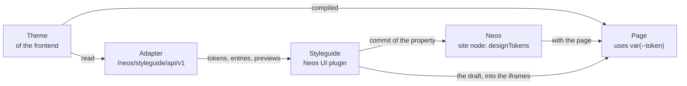

# How the design tokens and the styleguide work

This explains the whole way of a design token: from the theme of the frontend where it is defined, through Neos where a
site changes it, to the page that renders it; and how the styleguide in the Neos content module reads the tokens and
the components of the frontend. The [README](README.md) says what the package does, [PROTOCOL.md](PROTOCOL.md) is the
exact contract between the interface and a frontend. How an adapter does its part is explained by the adapter, e.g.
the ARCHITECTURE.md of the [SvelteKit adapter](https://github.com/Devclaim/Devclaim.NeosStyleguide.Adapter.Svelte).

## The parts

| Part | Where | Job |
| --- | --- | --- |
| Theme | the frontend (e.g. Tailwind `@theme` blocks) | defines every token with its default; the only list of tokens |
| Overrides of a site | Neos, the site node, property `designTokens` (`DesignTokensMixin`) | the tokens a site changes, one `--name: value;` per line |
| Pages of the site | the frontend | write the overrides of the site into the `<head>` of each page (checked by the adapter's rules) |
| Adapter | the frontend, e.g. `/neos/styleguide/api/v1` | answers the styleguide protocol: entries, tokens, previews |
| Neos API | this package, `/api/styleguide/v1/sites`, `/fonts` | the sites with their tokens in the editor's workspace, the fonts; for logged-in editors |
| Interface | this package, a plugin of the Neos UI | the styleguide in the content module and the editor of the tokens |

The interface knows nothing about the frontend: everything it shows comes from the adapter (protocol) and from the Neos
UI (the property). Another frontend (SvelteKit, Fusion or CPX) implements the adapter and keeps the interface.

## 1. Stored in Neos

The property `designTokens` of the site node holds the changed tokens as text, one `--name: value;` per line. It has
the scope of the node aggregate: one value for all languages. The mixin is part of this package
(`NodeTypes/Mixin/DesignTokensMixin.php`); the site package gives it to its site node type.

The frontend renders the overrides into the `<head>` of every page of the site (`` after its
stylesheet), after checking every line with the same rules the adapter applies to the draft (`POST …/tokens/validate`):
only known tokens, no build time tokens (breakpoints in media queries), values that cannot leave the declaration.
Publishing the site node has to purge the pages of the site, like any change of it.

For a frontend rendered by Neos (CPX, Fusion) this package reads the theme and has the rules itself
(`Classes/Tokens`: `ThemeTokens` parses the `@theme` blocks, `Theme` reads the stylesheets of setting
`Devclaim.NeosStyleguide.theme.stylesheets` and prints the `` at the end of their `<head>`, after the site's tokens. That works
    because the previews are on the same origin as the Neos UI. The frontend has no code for it.
4. After a pause (700 ms) and when every value is valid, the draft is saved into the editor's workspace
    (`neos-ui/neos.ts`): the change the Neos UI sends for an inline edit (`Neos.Neos.Ui:Property` on the site node,
    property `designTokens`). The Neos UI updates the node in its store, the draft ends, the publish counter of the
    top bar counts the change. The page in the canvas is behind the view: it is loaded again once, when the view
    closes, with the saved tokens (rendered the normal way), not after every save (no `reloadPageIfChanged`).

Publishing, discarding and the review in the workspace module are Neos' own. The value lives on the home page: "Diese
Seite veröffentlichen" contains it only while the home page is shown, "Alle veröffentlichen" always.

## 3. How the interface shows the tokens

The interface asks the adapter: `GET /neos/styleguide/api/v1/tokens`: every token with its default, group, kind
(the navigation of the tokens), type and whether a site may change it.

The interface then shows the defaults and the site's values side by side: the applied value of the property is "the
site", the uncommitted value the draft. To show a swatch for `var(--color-sd-50)` it resolves the chain of `var()`
through the tokens it got (`Resources/Private/JavaScript/tokens.ts`). The editor of a token depends on its type:
color picker and palette (`var(--color-…)` of the scales) for colors, a list of font stacks and the uploaded fonts for
fonts, text for the rest.

## 4. How the interface shows the components

The adapter lists the entries (`GET …/entries`: id, title, level, use cases, prop sets) and describes one with its
props and their editors (`GET …/entries/{id}`). The interface shows an entry in an iframe, the preview of the adapter
(`?entry=ui.Button&site=…` plus `useCase`, `propSet`, `props`).

The "Elemente" screen shows the gallery (PROTOCOL.md "Gallery", every entry with its defaults in one page) in one
iframe at the width of Mobile or Desktop, scaled into the room, with the interface's labels over the room it reserves
above each entry (`components/Gallery.tsx`); whole pages and full screen entries are only shown alone. A page
(`page: true`) is shown at the height of its room, scrolled inside its frame like in a browser window, without props
and used tokens (a frame as high as the page would make its `vh`, sticky and fixed elements wrong).

The preview is a plain page. The interface works on it itself (`frames.ts`, PROTOCOL.md "What the interface does with
it"): it puts the draft into its head (2.), sizes the iframe to the bottom of the root element, reads the tokens the
entry uses (the `var(--…)` of every style rule that matches the root or an element in it, shown as "Verwendet") and
sets the grid attribute.

A new preview URL (another element, use case, prop) never shows an empty frame: it loads in a second, hidden iframe,
gets the draft and its height there and then takes the place of the shown one (`components/usePreviewFrame.tsx`).

## 5. The interface in the Neos UI

The package builds one bundle, `Resources/Public/NeosUi/Plugin.js` (`yarn build`), loaded by the Neos UI
(`Neos.Neos.Ui.resources` in `Configuration/Settings.yaml`). React and the Neos UI components come from the Neos UI
itself (`@neos-project/neos-ui-extensibility`), so the plugin is small and looks like the rest of Neos. The adapter URL
and the fonts endpoint come from the `frontendConfiguration` `Devclaim.NeosStyleguide` of the Neos UI.

The plugin registers two containers of the Neos UI (`Resources/Private/JavaScript/neos-ui/index.tsx`):

- **"Styleguide" in the top bar** (`PrimaryToolbar/Right`, before the language switcher), on every page.
- **The view** (`Modals/Devclaim.NeosStyleguide/View`) below the top bar, over the page tree, the canvas and the
    inspector:
    - the navigation (`components/Rail.tsx`: Tokens by kind, or Elemente by level; a search over both,
        `search.ts`)
    - the screens (the tokens of a kind, the gallery, one element with use cases, viewports, the page grid, props and
        the tokens it uses)
    - the design panel (`neos-ui/DesignPanel.tsx`) where the inspector would be: the editor of the selected token, or
        every token by kind with a search (`components/TokenBrowser.tsx`), and a problem with saving (only then)

The view reads the site node and its tokens from the Neos UI store (`neos-ui/neos.ts`) and saves through it, so it
does not depend on the page that is shown. Its own state (open, selected token, draft, saving) is a small store
outside React (`neos-ui/store.ts`): it survives closing the view.

## 6. Recipes

- **Checking an adapter:** the base distribution's `Benchmarks/browser/styleguide-protocol.mjs <origin>` (the
    protocol) and `styleguide.mjs <origin>` (the whole styleguide in the content module).
- **Another frontend:** implement PROTOCOL.md (the JSON of the adapter API and a preview page; no script), step by
    step in its "Writing an adapter", and point `adapter` of the `frontendConfiguration` to it. The pages must be on the
    origin of the Neos backend.
